<div align="center">


### AI-powered health screening, assistance, blood-donor network & emergency coordination
**Screen → understand → ask → find help → act, all in one place**

[](#-license)


-1f5a4b?style=flat-square&logo=postgresql&logoColor=white)


**[🌐 Live App](https://vital-ai-tau.vercel.app) · [⚙️ API Docs](https://vitalai-api-uepo.onrender.com/docs) · [📦 Repository](https://github.com/Oliveya-15/VitalAI)**

</div>

<br/>

> ⚠️ **VitalAI is an educational screening and coordination tool, not a medical device.** It never diagnoses, prescribes or replaces a doctor. In an emergency, call your local ambulance number (**108 / 112 in India**).

<br/>

## 📑 Table of Contents

- [🎯 The Problem](#-the-problem)
- [✨ What VitalAI Does](#-what-vitalai-does)
- [📸 Screenshots](#-screenshots)
- [🩺 How Diagnosis Works](#-how-diagnosis-works)
- [🤖 The AI Health Assistant](#-the-ai-health-assistant)
- [🩸 Blood Network Matching](#-blood-network-matching)
- [🚑 Emergency & Ambulance](#-emergency--ambulance)
- [🔐 Authentication & Privacy](#-authentication--privacy)
- [🧱 Architecture & Workflow](#-architecture--workflow)
- [🧰 Tech Stack](#-tech-stack)
- [🌍 Free Deployment Setup](#-free-deployment-setup)
- [🔗 Live Demo](#-live-demo)
- [⚡ Getting Started](#-getting-started)
- [🔧 Environment Variables](#-environment-variables)
- [🔌 API Overview](#-api-overview)
- [📁 Project Structure](#-project-structure)
- [🧪 Honest Limitations](#-honest-limitations)
- [🧭 Roadmap](#-roadmap)
- [📄 License](#-license)
- [🙏 Acknowledgments](#-acknowledgments)

<br/>

---

## 🎯 The Problem

| | |
|---|---|
| **Scattered tools** | Health screening, medical information, blood-donor searches and emergency contacts live in different apps, so help is slow to find when it matters. |
| **Opaque predictions** | Many online "risk checkers" give a number with no explanation of what drove it, and no honesty about how reliable it is. |
| **Ad-hoc blood searches** | Finding a compatible donor usually means forwarding messages in group chats, with no check of blood-group compatibility, distance or whether the donor is even allowed to give blood yet. |
| **Slow emergency response** | In a crisis, people lose time deciding how serious symptoms are, finding the nearest hospital and locating the right number to call. |
| **Privacy risk** | Health tools that ask for sign-up often keep data forever, with no simple way to see it or delete it. |

**VitalAI's answer:** one signed-in platform where you can run explainable ML screenings, ask an AI assistant grounded in a medical knowledge base, request blood from compatible nearby donors, check symptoms for emergency red flags, find nearby hospitals on a map and request an ambulance, with every action recorded in a personal history you control.

<br/>

---

## ✨ What VitalAI Does

<p align="center">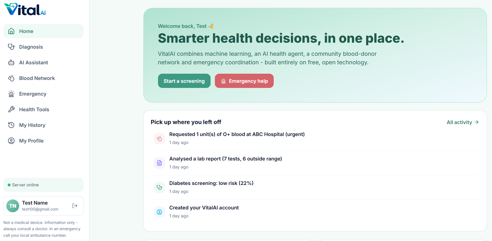</p>
<p align="center"><sub><strong>Home</strong>: personalised dashboard with recent activity and shortcuts to every module</sub></p>

- 🩺 **AI Diagnosis:** screen for **diabetes, heart disease and Parkinson's disease**. Four model families are compared per disease and the best is chosen by cross-validation. Every result shows a risk level, a probability and the **top factors that drove it**.
- 🤖 **AI Health Assistant:** a chat agent that can answer from a built-in medical knowledge base, run the screening models, count eligible blood donors and look up nearby hospitals. It works **with or without** an LLM key.
- 🩸 **Blood Network:** register as a donor, post blood requests and see compatible donors ranked by exact match and distance. Rest-period eligibility, consent and self-delete are built in.
- 🚑 **Emergency:** symptom triage with deterministic red-flag detection, one-tap emergency numbers, nearby hospitals / clinics / pharmacies on a Leaflet map, address search, Google Maps directions and an ambulance request tracker.
- 🛠️ **Health Tools:** BMI, blood-pressure category and a **lab-report reader** that flags values outside standard ranges.
- 👤 **Profile & History:** a personal profile with activity stats, a full timeline of everything you did, per-screening history, password change and **delete-my-account**.
- 🔐 **Real authentication:** register and login with salted-scrypt password hashing and JWT sessions. Every health feature is behind login, while **emergency numbers and triage stay public** on purpose.
- 🟢 **Always-visible server status:** a live indicator in the sidebar, plus a wake-up ping, because the free backend tier sleeps.
- 📱 **Responsive:** the whole app works on phones.

<br/>

---

## 📸 Screenshots

<table>
<tr>
<td width="50%">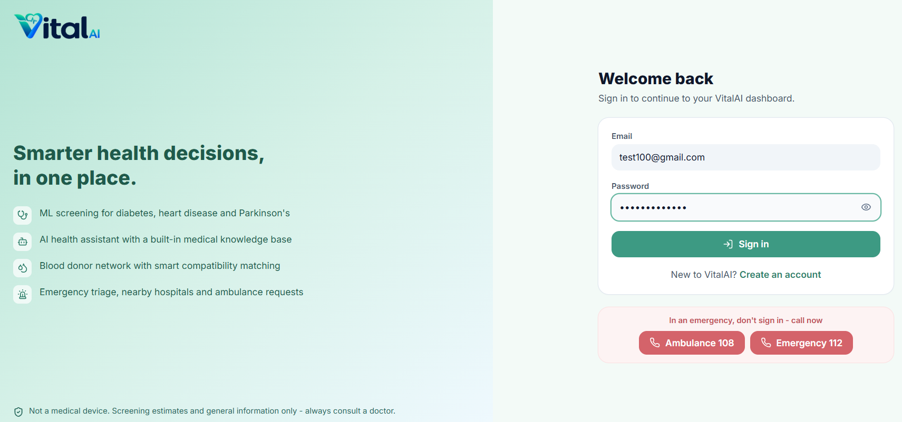<p align="center"><sub><strong>Login</strong>: with emergency call buttons that need no sign-in</sub></p></td>
<td width="50%">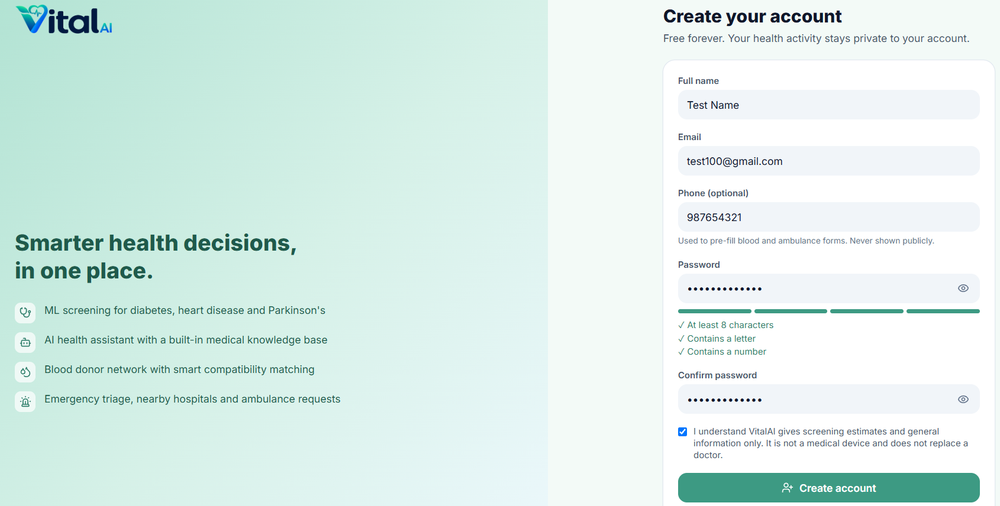<p align="center"><sub><strong>Register</strong>: live password-strength rules</sub></p></td>
</tr>
<tr>
<td width="50%">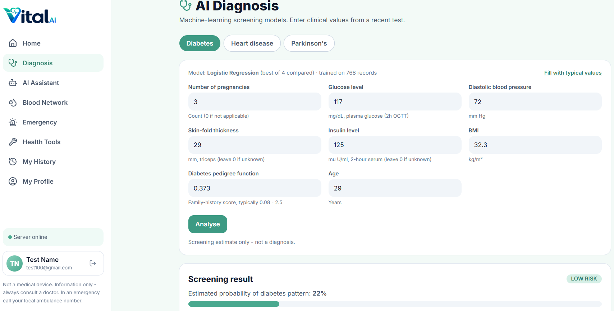<p align="center"><sub><strong>Diagnosis</strong>: one tab per disease, form generated from model metadata</sub></p></td>
<td width="50%">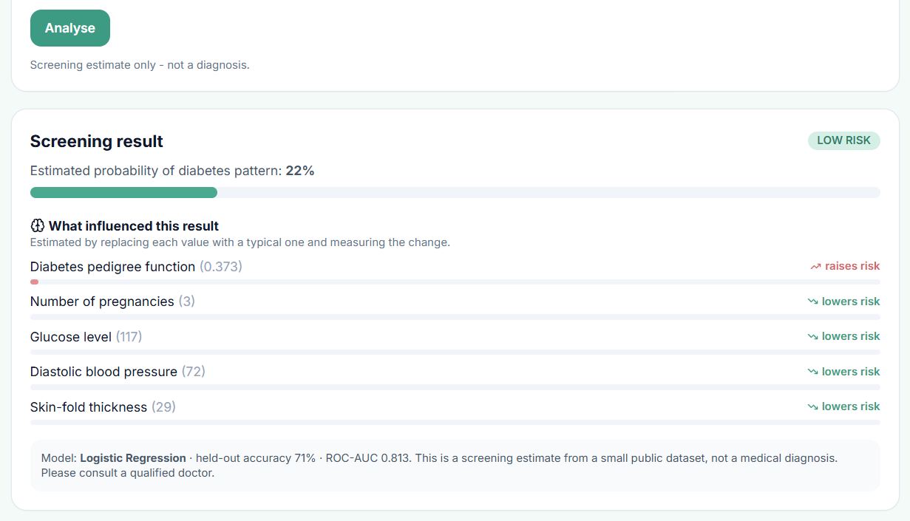<p align="center"><sub><strong>Result</strong>: risk level, probability and the factors that drove it</sub></p></td>
</tr>
<tr>
<td width="50%">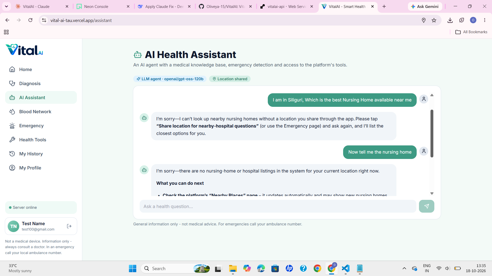<p align="center"><sub><strong>AI Assistant</strong>: grounded answers with sources and tools used</sub></p></td>
<td width="50%">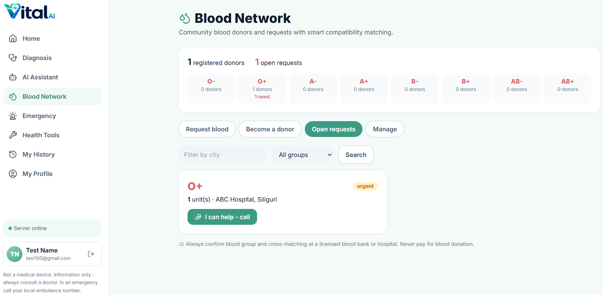<p align="center"><sub><strong>Blood Network</strong>: donors, requests and compatibility matching</sub></p></td>
</tr>
<tr>
<td width="50%">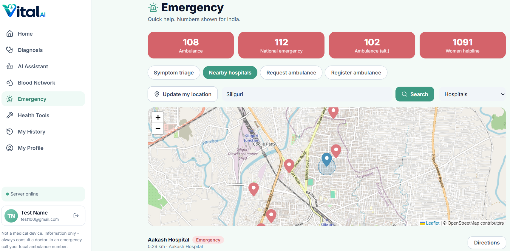<p align="center"><sub><strong>Emergency</strong>: nearby hospitals on a map, with directions</sub></p></td>
<td width="50%">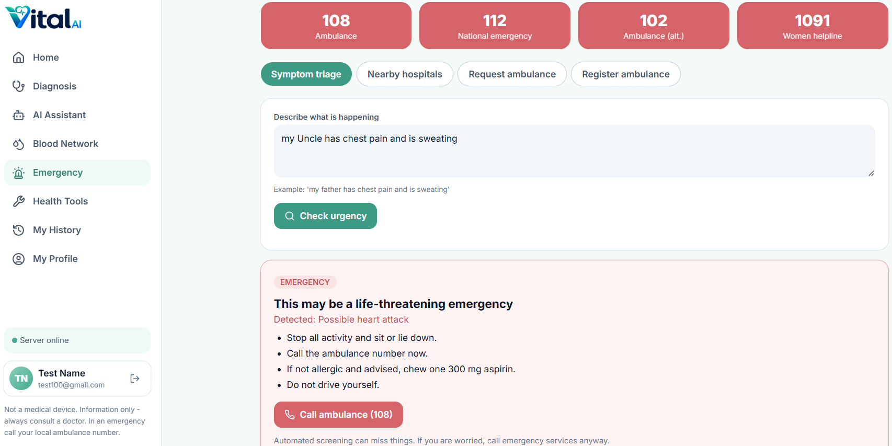<p align="center"><sub><strong>Symptom triage</strong>: instant red-flag detection with a call button</sub></p></td>
</tr>
<tr>
<td width="50%">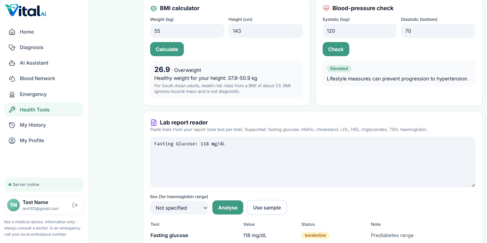<p align="center"><sub><strong>Health Tools</strong>: BMI, blood pressure and lab-report reader</sub></p></td>
<td width="50%">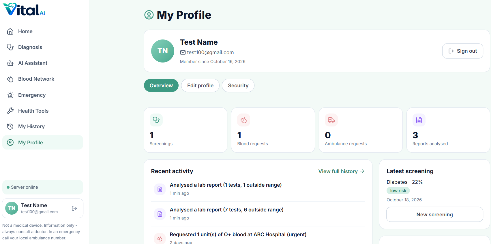<p align="center"><sub><strong>Profile</strong>: stats, recent activity and account settings</sub></p></td>
</tr>
</table>

### 🕘 My History

<p align="center">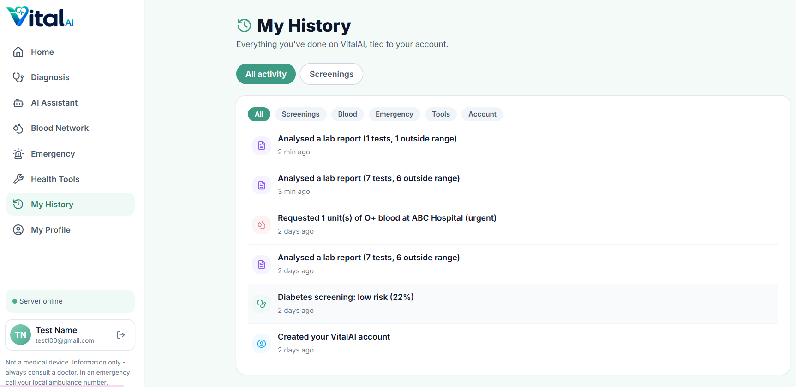</p>
<p align="center"><sub><strong>History</strong>: every action tied to your account, filterable by category</sub></p>

### 📱 Mobile

<table align="center">
<tr>
<td align="center" width="50%">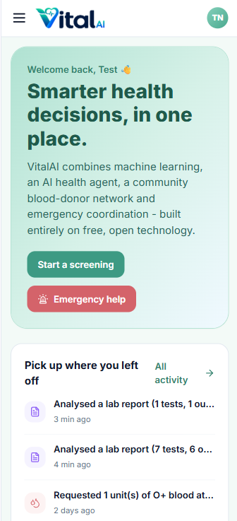<p><sub><strong>Mobile (1/2)</strong>: dashboard with the slide-out menu</sub></p></td>
<td align="center" width="50%">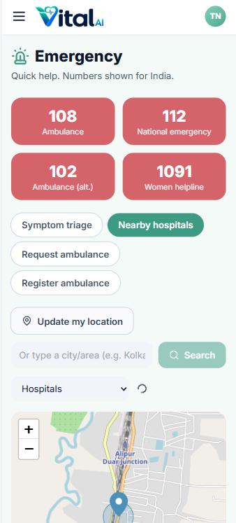<p><sub><strong>Mobile (2/2)</strong>: emergency numbers and nearby help</sub></p></td>
</tr>
</table>

<p align="center"><sub>📱 The layout is responsive, so emergency help works straight from a phone.</sub></p>

<br/>

---

## 🩺 How Diagnosis Works

<p align="center">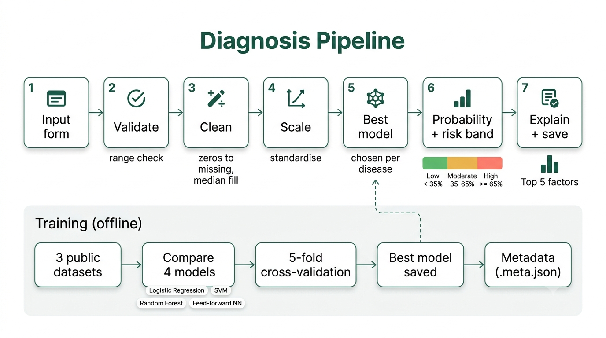</p>

Every screening walks the same pipeline:

| # | Stage | What happens |
|---|---|---|
| 1 | **Validate** | Every field must be present and plausible. Values far outside the range seen in the training data (more than 3× its span) are rejected as likely typos. |
| 2 | **Clean** | For the diabetes model, a `0` in glucose, blood pressure, skin thickness, insulin or BMI means "not measured" and is treated as missing, then filled with the training median. |
| 3 | **Scale** | Features are standardised with a scaler fitted on the training data. |
| 4 | **Predict** | The best model for that disease returns a probability. |
| 5 | **Band the risk** | Below 35 % is **low**, 35 to 65 % is **moderate**, 65 % and above is **high**. |
| 6 | **Explain** | A model-agnostic *what-if* check replaces each input in turn with a typical value and measures how far the probability moves. The **top 5 factors** are shown, marked as raising or lowering risk. |
| 7 | **Save** | The result is stored in your history and activity timeline. |

### Model selection

For each disease, four model families are trained and compared with **5-fold stratified cross-validation** on an 80 % training split. The winner is evaluated once on the held-out 20 %, then refitted on all data for deployment.

| Disease | Records | Best model | CV ROC-AUC | Test accuracy | Test recall | Test ROC-AUC |
|---|---|---|---|---|---|---|
| **Diabetes** | 768 | Logistic Regression | 0.843 | 70.8 % | 50.0 % | 0.813 |
| **Heart disease** | 303 | Logistic Regression | 0.890 | 80.3 % | 90.9 % | 0.869 |
| **Parkinson's** | 195 | Feed-forward Neural Network | 0.968 | 94.9 % | 96.6 % | 0.990 |

Candidates compared: **Logistic Regression · SVM (RBF) · Random Forest · Feed-forward NN (MLP)**. The full leaderboard is stored in each model's `*.meta.json` and shown on the Diagnosis page.

> These are small public datasets, so the numbers are honest *educational* results. See [Honest Limitations](#-honest-limitations).

**Metadata-driven by design:** each trained model ships a `*.meta.json` (fields, ranges, medians, metrics). The form, validation and explanation are all generated from it, so adding a new tabular disease means adding one CSV and one config entry in `backend/ml/train.py`.

**Self-healing models:** if the stored model files are missing or were built with a different scikit-learn version, the backend automatically retrains from the bundled CSVs at startup.

<br/>

---

## 🤖 The AI Health Assistant

<p align="center">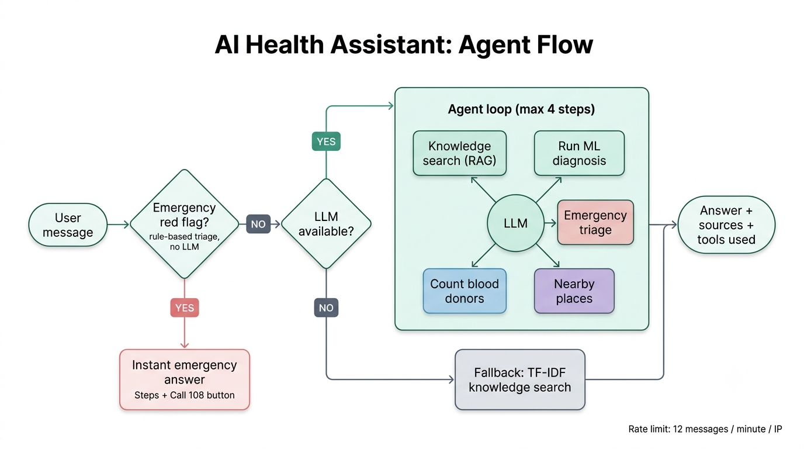</p>

The assistant is an **agent**, not a plain chatbot. Every message follows the same safe flow:

1. **Safety first.** Deterministic emergency triage runs on the message *before* anything else. A genuine red flag (for example "my father has chest pain") returns an immediate emergency answer with a call button, with **no LLM involved**, so it is instant and cannot hallucinate. General questions like "what are the signs of a stroke?" are recognised as education, not an emergency.
2. **Agent loop (LLM available).** The model can call up to **5 tools**, for at most 4 steps per message:

| Tool | What it does |
|---|---|
| `search_health_knowledge` | RAG lookup in the curated knowledge base |
| `run_diagnosis` | Runs the platform's own ML screening models |
| `emergency_triage` | Red-flag check on free text |
| `count_blood_donors` | Counts eligible compatible donors in a city (counts only, never contact details) |
| `nearby_places` | Finds nearby hospitals, clinics or pharmacies from the user's shared location |

3. **Graceful fallback.** With no LLM key, or if the provider is down, the assistant answers from the same knowledge base using TF-IDF retrieval, so it never breaks.

**Knowledge base:** 20 curated entries covering diabetes, heart attack and stroke warning signs, Parkinson's, hypertension, blood-donation eligibility and compatibility, first aid (bleeding, burns, choking, CPR, seizures), fever, dehydration and mental wellbeing. Retrieval uses **TF-IDF with bigrams** (scikit-learn), with cosine similarity.

**Guardrails:** a system prompt forbids diagnosis and prescriptions, answers are kept short, sources and tools used are shown under each reply, and chat is rate-limited per IP to protect the free LLM quota.

<br/>

---

## 🩸 Blood Network Matching

<p align="center">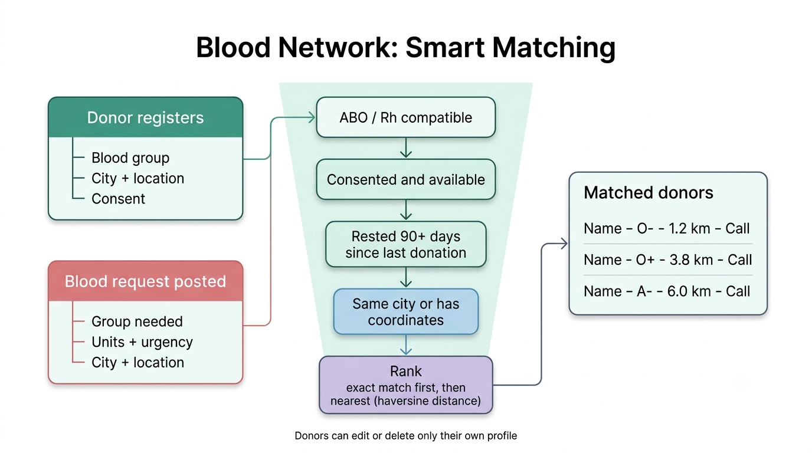</p>

When someone posts a blood request, donors are filtered and ranked by explicit, documented rules:

| Rule | How it works |
|---|---|
| **ABO / Rh compatibility** | A table maps each recipient group to the donor groups whose **red cells** they can safely receive (for example O- can give to anyone, AB+ can receive from anyone). |
| **Rest period** | A donor who gave blood within the last **90 days** is excluded automatically (`DONOR_REST_DAYS`, configurable). |
| **Consent** | Donors must explicitly agree to be contacted. Opted-out or unavailable donors never appear. |
| **Location** | If both sides shared coordinates, distance is calculated with the **haversine formula**. Otherwise a donor must be in the same city. |
| **Ranking** | `score = (0 if exact group match else 5) + distance_km` (or 15 when distance is unknown). Lower is better. |

**Ownership & control:** a donor profile can only be edited or removed by the account that registered it, so nobody can overwrite or delete someone else's record just by knowing a phone number. Requests can only be closed by their creator, and donors can delete their own data at any time.

<br/>

---

## 🚑 Emergency & Ambulance

| Feature | Details |
|---|---|
| **Emergency numbers** | 108, 112, 102 and 1091 (India defaults) shown as one-tap call buttons. They are also on the login page and need **no account**. Configurable per country. |
| **Symptom triage** | Rule-based detection of **10 emergency categories** (heart attack, stroke, breathing emergency, severe bleeding, unconsciousness or seizure, poisoning, anaphylaxis, self-harm risk, severe injury, pregnancy emergency). Returns *emergency / urgent / routine* with immediate steps and a call button. Deliberately **not** machine-learned or LLM-based. |
| **Nearby places** | Hospitals, clinics and pharmacies within the search radius, sorted by distance, via the **Geoapify Places API** (free tier), shown on an interactive **Leaflet + OpenStreetMap** map. |
| **Address search** | Type a city or area instead of using GPS. Geocoding uses Geoapify first and falls back to **OpenStreetMap Nominatim**. |
| **Directions** | One tap opens a Google Maps route from the user's location, with no API key needed. |
| **Ambulance request** | Pick severity and location. The request moves through a tracked lifecycle: `requested → dispatched → on_the_way → arrived → completed` (or `cancelled`). The page polls for updates. The nearest verified ambulances are suggested with direct call buttons. |
| **Operator registry** | Ambulance operators can register their vehicles, which stay **hidden until an administrator verifies them**. Admin actions use a separate secret key. |

Every ambulance request shows a clear reminder that the platform coordinates help but cannot guarantee a response, and that **life-threatening emergencies must call the national number first.**

<br/>

---

## 🔐 Authentication & Privacy

<p align="center">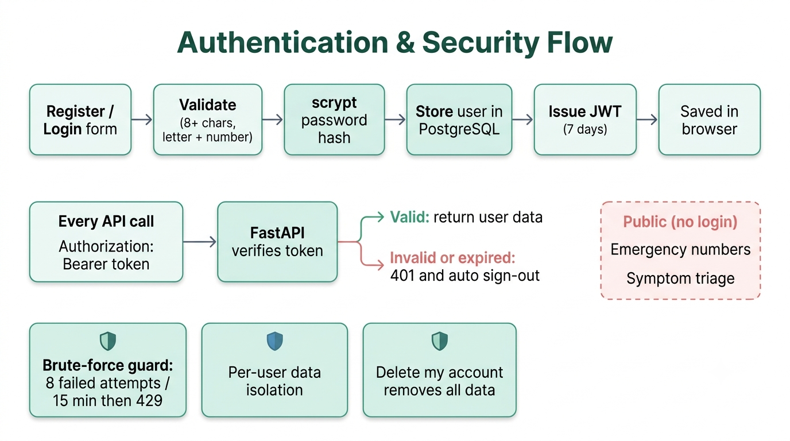</p>

| Area | Implementation |
|---|---|
| **Passwords** | Hashed with **scrypt** (salted, memory-hard) from Python's standard library. Plain passwords are never stored. Rules: 8+ characters with a letter and a number. |
| **Sessions** | Signed **JWT** (HS256), 7-day expiry, sent as a Bearer token. An expired or invalid token signs the user out cleanly with a message. A saved token is kept if the server is merely asleep. |
| **Brute-force guard** | 8 failed logins for the same email and IP within 15 minutes block further attempts for the window. Unknown emails cost the same response time as real ones, so accounts cannot be discovered by timing. |
| **Route protection** | Every feature page and API endpoint requires login, except emergency numbers and symptom triage, which stay public so nobody in a crisis has to sign up. |
| **Data isolation** | Screenings and activity belong to the signed-in account and are invisible to every other user. |
| **Your data, your control** | Profile editing, password change and **delete-my-account**, which removes the account and the data created through it (screenings, activity, blood requests, donor profile and ambulance records). |
| **Safe upgrades** | A small startup migration adds new columns to existing databases without losing data. |

<br/>

---

## 🧱 Architecture & Workflow

<p align="center">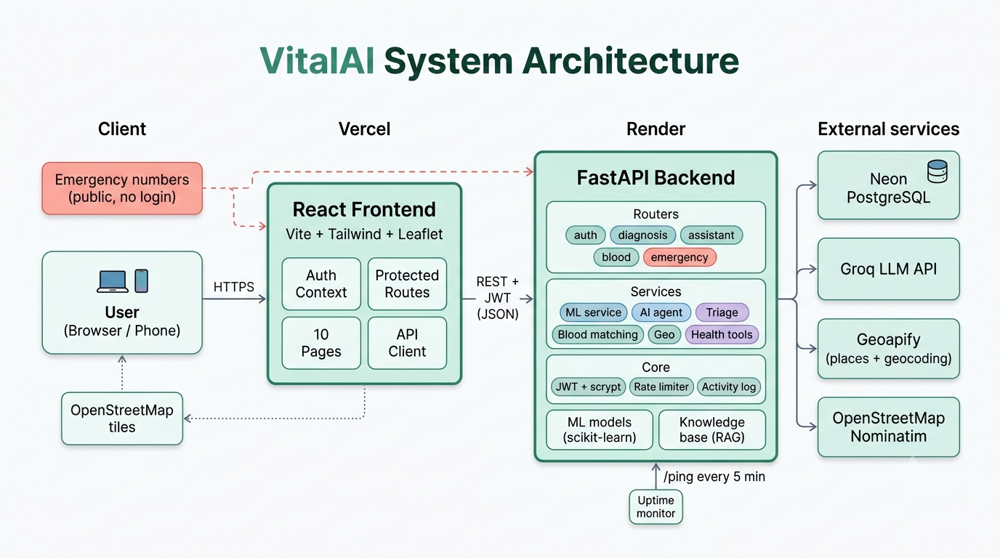</p>

<p align="center">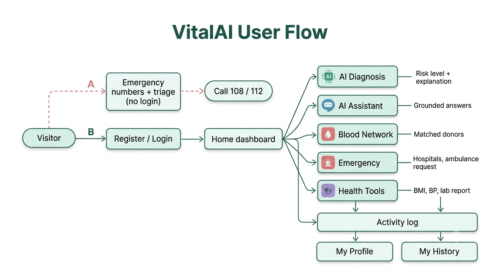</p>

VitalAI is a **modular monolith**: one backend process, one database and one frontend build, with every concern in its own folder so any part can be read, tested or replaced on its own.

| Layer | Responsibility |
|---|---|
| `routers/` | Thin HTTP handlers: validation in, JSON out |
| `services/` | Business logic: ML inference and explanation, the AI agent, triage, blood matching, geo lookups, health tools, activity logging |
| `ml/` | Training pipeline, datasets and versioned model artifacts, separable from the web app |
| `models.py` · `schemas.py` | SQLAlchemy tables and Pydantic request / response contracts |
| `core/` | Configuration, logging and security (password hashing, tokens) |
| `frontend/src/` | React pages, shared components, an auth context and a single API client |

**Design principles:**

- **No fake AI.** Probabilities come from real models, explanations from a documented method, and when a service is unavailable the app says so instead of inventing an answer.
- **Safety is deterministic.** Emergency detection is plain code that always works, never an LLM.
- **Graceful degradation.** No LLM key, an LLM outage or a busy map service never crashes the app.
- **Free-tier realism.** Lightweight scikit-learn models fit comfortably in 512 MB of RAM.

<br/>

---

## 🧰 Tech Stack

<p align="center">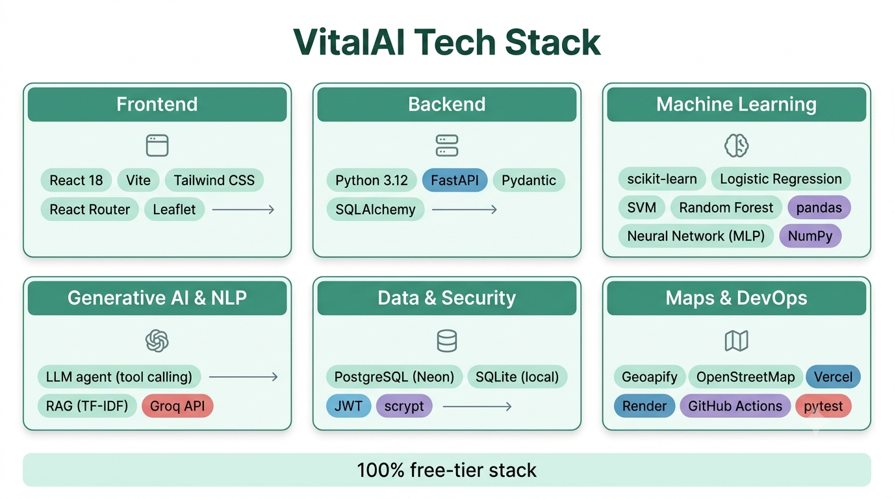</p>

<table>
<tr><th>Layer</th><th>Technology</th></tr>
<tr><td>Frontend</td><td>React 18 · Vite · React Router · Tailwind CSS · Leaflet / React-Leaflet · Lucide icons</td></tr>
<tr><td>Backend</td><td>Python 3.12 · FastAPI · Pydantic · SQLAlchemy 2</td></tr>
<tr><td>Database</td><td>PostgreSQL on Neon (production) · SQLite (local, zero setup)</td></tr>
<tr><td>Machine Learning</td><td>scikit-learn: Logistic Regression, SVM, Random Forest, MLP (feed-forward NN) · pandas · NumPy · joblib</td></tr>
<tr><td>NLP / RAG</td><td>TF-IDF retrieval (scikit-learn) over a curated knowledge base</td></tr>
<tr><td>Generative AI</td><td>Any OpenAI-compatible LLM API (Groq in production) with tool-calling and a rule-based fallback</td></tr>
<tr><td>Auth & Security</td><td>scrypt password hashing · JWT (PyJWT) · login rate limiting · CORS allow-list</td></tr>
<tr><td>Maps & Geo</td><td>Geoapify (places + geocoding) · OpenStreetMap Nominatim fallback · Leaflet + OSM tiles · Google Maps directions links</td></tr>
<tr><td>Testing & CI</td><td>pytest (20 tests) · GitHub Actions (backend tests + frontend build)</td></tr>
<tr><td>Deployment</td><td>Vercel (frontend) · Render (backend) · Neon (PostgreSQL)</td></tr>
</table>

**No paid service is required anywhere in this stack.** The database, hosting, maps and LLM all run on free tiers.

<br/>

---

## 🌍 Free Deployment Setup

<p align="center">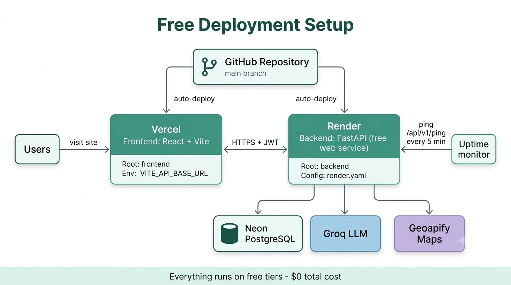</p>

| Part | Host | Why |
|---|---|---|
| Frontend | **Vercel** | Free static hosting, auto-deploys from GitHub, SPA rewrites in `vercel.json` |
| Backend | **Render** (free web service, 512 MB) | Runs FastAPI straight from the repository, defined in `render.yaml` |
| Database | **Neon** (free PostgreSQL) | Render's free Postgres expires after 30 days, Neon's free tier does not |
| Maps | **Geoapify** (free tier) | Nearby places and address search |
| Chat LLM | **Groq** (free tier) | OpenAI-compatible API configured through environment variables |

**Key engineering decisions:**

- **Models stay lightweight.** scikit-learn pipelines load in well under a second and fit the free tier, with no deep-learning runtime required in production.
- **Tackling the free-tier sleep.** Render's free service spins down after about 15 minutes of inactivity. The frontend pings the server the moment it opens (even on the login page) and every 10 minutes while a tab is open, API calls wait up to 70 seconds instead of failing, and an external uptime monitor can ping `/api/v1/ping` every 5 minutes for always-warm behaviour.
- **Fail-fast secrets.** In production the backend refuses to start without a signing secret, rather than silently running insecurely.

**Deploy it yourself:** the full step-by-step guide is in [`docs/SETUP_GUIDE.md`](docs/SETUP_GUIDE.md).

> ⏳ The backend is on Render's free tier, so the first request after a period of inactivity can take up to a minute to wake up. That is infrastructure, not a bug.

<br/>

---

## 🔗 Live Demo

| | |
|---|---|
| 🌐 **App** | [vital-ai-tau.vercel.app](https://vital-ai-tau.vercel.app) |
| ⚙️ **API docs** | [vitalai-api-uepo.onrender.com/docs](https://vitalai-api-uepo.onrender.com/docs) |
| 📦 **Source** | [github.com/Oliveya-15/VitalAI](https://github.com/Oliveya-15/VitalAI) |

> 🔑 Create a free account on the register page to explore every feature. Please use test details, not real medical data.

<br/>

---

## ⚡ Getting Started

**Requirements:** Python 3.11+ and Node.js 18+. No database setup is needed locally, the backend uses a SQLite file.

### 1. Clone

```bash
git clone [https://github.com/Oliveya-15/VitalAI.git](https://github.com/Oliveya-15/VitalAI.git)
cd VitalAI
```

<div align="center">

**Designed, built and deployed end to end on free-tier infrastructure.**

<sub>VitalAI · AI Health Platform · 2026</sub>

</div>